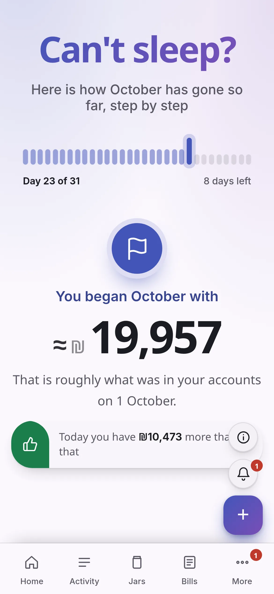

<div align="center">


# Money Manager

**All your money in one private place that only you can see.**

Your Israeli banks, credit cards, Wise and savings, gathered automatically on **your own computer or server**, and turned into something you can understand: bills, budgets, savings jars, reports, alerts and a forecast. Read-only: it can never move money.

[](../../releases/latest)

**[Documentation](https://userofit123.github.io/moneymanager/)** · **[Install](docs/install.md)** · **[Your first 15 minutes](docs/getting-started.md)** · **[A tour of every screen](docs/tour.md)** · **[Security](docs/security.md)**

<picture>
  <source media="(prefers-color-scheme: dark)" srcset="docs/screenshots/home-dark.webp">
  
</picture>

</div>

## What it is

- **Private.** It runs on your own machine. There is no account with us and nothing is sent to us. Your bank logins are encrypted and are never shown again, not even to you.
- **Read-only.** It reads balances and transactions. No code in the app can start a transfer, a payment or an approval.
- **Plain.** No financial words. English and Hebrew (right to left), on a computer or a phone, light or dark.
- **Does the sorting for you.** Finds your bills, pairs transfers between your own accounts, ignores duplicates, does not count a credit card bill twice, and tells you when it is unsure.
- **Free and open source.** No AI in the core, no tracking, no ads.

## What you get

<table>
<tr>
<td width="50%"><picture><source media="(prefers-color-scheme: dark)" srcset="docs/screenshots/recap-dark.webp"></picture><br><b>Recap.</b> Your month so far, told in plain sentences with a graph each.</td>
<td width="50%"><picture><source media="(prefers-color-scheme: dark)" srcset="docs/screenshots/forecast-dark.webp"></picture><br><b>Forecast.</b> Where your balance is heading, and whether it ever dips below zero.</td>
</tr>
<tr>
<td><picture><source media="(prefers-color-scheme: dark)" srcset="docs/screenshots/activity-dark.webp"></picture><br><b>Activity.</b> Every payment from every account, searchable, with what needs a look.</td>
<td><picture><source media="(prefers-color-scheme: dark)" srcset="docs/screenshots/jars-dark.webp"></picture><br><b>Jars.</b> Set money aside inside your account for what matters, in the order you choose.</td>
</tr>
<tr>
<td><picture><source media="(prefers-color-scheme: dark)" srcset="docs/screenshots/bills-dark.webp"></picture><br><b>Bills.</b> Found automatically, predicted ahead, with price changes flagged.</td>
<td><picture><source media="(prefers-color-scheme: dark)" srcset="docs/screenshots/budgets-dark.webp"></picture><br><b>Budgets.</b> Know if you are spending too fast, before the month is over.</td>
</tr>
<tr>
<td><picture><source media="(prefers-color-scheme: dark)" srcset="docs/screenshots/reports-dark.webp"></picture><br><b>Reports.</b> Net worth, spending by category, income against expenses, top stores.</td>
<td><picture><source media="(prefers-color-scheme: dark)" srcset="docs/screenshots/home-he-dark.webp"></picture><br><b>Hebrew.</b> The whole app, right to left. Alerts reach your phone, ntfy, Telegram or a webhook.</td>
</tr>
</table>

<p align="center">
<picture><source media="(prefers-color-scheme: dark)" srcset="docs/screenshots/mobile-home-dark.webp"></picture>
<picture><source media="(prefers-color-scheme: dark)" srcset="docs/screenshots/mobile-recap-dark.webp"></picture>
<picture><source media="(prefers-color-scheme: dark)" srcset="docs/screenshots/mobile-home-he-dark.webp"></picture>
</p>

Banks and cards: Hapoalim, Leumi, Discount, Mercantile, Mizrahi-Tefahot, Otsar Hahayal, Union, First International, Massad, Yahav, Max, Isracard, Visa Cal, American Express and Wise, plus a CSV import for anything else. All screenshots use made-up demo data.

## Install

Pick one. They look and work the same.

| | For | How |
|---|---|---|
| **[Windows app](docs/install-windows.md)** | One PC. The easiest. | Download **Money-Manager-Setup-x.y.z.exe** from the [latest release](../../releases/latest) and run it. Nothing else to set up. |
| **[Linux app](docs/install-linux.md)** | One computer: Fedora, Ubuntu, Debian, anything | Download the **.rpm** (Fedora, Red Hat), **.deb** (Ubuntu, Debian, Mint) or **.AppImage** (any). |
| **[Docker](docs/install-docker.md)** | A home server or NAS, always on, for all your devices | `git clone` + `./setup.sh` + `docker compose up -d` |
| **[Android app](docs/install-android.md)** | Your phone, with a fingerprint or screen lock | Download **Money-Manager-x.y.z.apk** from the [latest release](../../releases/latest), then add your server |
| **[Your phone (web page)](docs/install-phone.md)** | Looking at it from anywhere | Open your server's address and **Add to Home Screen** |
| **[Desktop app + your server](docs/desktop-server.md)** | The desktop app, using your home server's data | Choose **My server** the first time you open the app |

**Docker in three lines:**

```sh
git clone https://github.com/userofit123/moneymanager.git && cd moneymanager
./setup.sh                      # creates .env with random secrets, once
docker compose up -d            # pulls the app and the scraper and starts everything
```

Open **http://localhost:8787** and choose a password. **Just want to look around?** Start it with made-up demo data instead: `docker compose -f docker-compose.yml -f docker-compose.demo.yml up -d --build` (an empty database only, never for real data).

New here? [Choose how to run it](docs/install.md) explains the differences in plain words.

## First steps

1. **Choose a password** and turn on **two-factor sign-in** (Settings → Security).
2. **Connect your banks** (Settings → Connections): pick the bank, type the login once, **Test connection**, **Sync now**.
3. **Let it sort** (Settings → Automatic sorting): set it up with an AI chat you already use, or write a few rules.
4. **Look around:** Home, Recap, Activity. Check **Needs review** now and then.

The full walk-through with pictures is [Your first 15 minutes](docs/getting-started.md).

## Updating

- **Windows and Linux apps** update themselves. Your data stays.
- **Docker:** `docker compose pull && docker compose up -d`, or from Docker Desktop, Portainer, Dockhand or Watchtower. See [Updating](docs/updating.md).

## Security in short

- **Read-only.** It only reads. No screen or code can send an instruction to a bank.
- **Logins are encrypted** (AES-256-GCM), write-only and scrubbed from every log. The key is protected by your Windows account or Linux keyring, or lives in a file in the app's volume (Docker).
- **Stays on your machine.** Nothing goes anywhere except to your own banks, Wise and a free exchange-rate service.
- Two failed logins pause a source, so a bank never locks your account.

Honest limits: whoever can open your computer or server can use the app as you, so use a strong password, two-factor sign-in and disk encryption. For the strongest guarantee, use a **view-only** login at your bank if it offers one. The full audit is in [Security](docs/security.md).

## Help

| Problem | Fix |
|---|---|
| Forgot the app password | `docker compose exec app node src/cli.js set-password` |
| Lost the authenticator | `docker compose exec app node src/cli.js disable-2fa` |
| A source says **Locked** | Fix the login in Settings → Connections, then **Unlock** |
| The bank wants a one-time code | Settings → Connections → **Verify this device** |
| Port 8787 is taken | Set `APP_PORT=9000` in `.env`, then `docker compose up -d` |

More in [Troubleshooting](docs/troubleshooting.md), [How it works](docs/how-it-works.md) and the [change log](CHANGELOG.md) ([Hebrew](CHANGELOG.he.md)).

## For developers

Tests, builds, releases and the folder map are in [For developers](docs/developers.md). The short version:

```sh
cd server && npm install && DB_DRIVER=pglite PGLITE_DIR=memory:// npm test   # server tests, no Postgres needed
(cd frontend && npm ci && npm test && npm run build)                          # the app: tests, then the build
```

Releases are automatic: `node scripts/bump.mjs minor`, fill in both changelogs, merge to `main`. The documentation site (`docs/`) is built and published by GitHub Pages.

## Status

Built: sign-in with two-factor, encrypted write-only bank logins, the scraper service, Wise (API and CSV), bank CSV import, duplicate handling, rules, transfers, missing-money detection, exchange rates, receipts, the scheduler, alerts and phone push, the PWA, Docker, the Windows and Linux apps with automatic updates and a choice of this computer or your own server, backup, Hebrew.

**Not verified:** the scrapers and the Wise token have been tested against fake services only, not the real banks, so expect to adjust once you try your own. Hapoalim one-time codes need **Verify this device**. **Not built:** split transactions, budget rollover, Excel (non-CSV) import.
