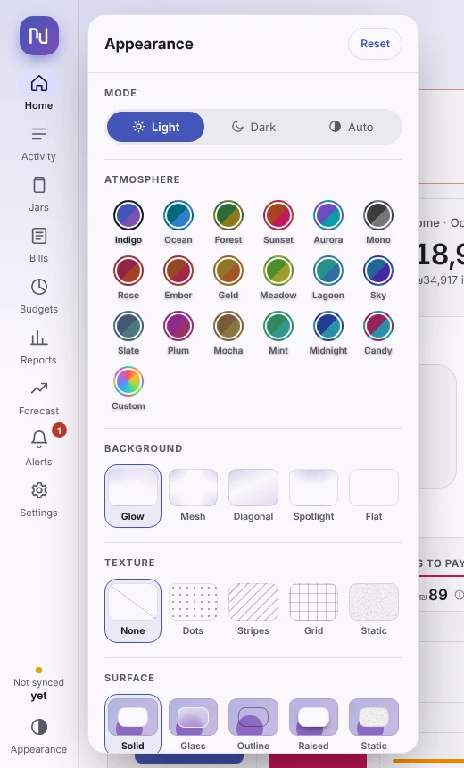
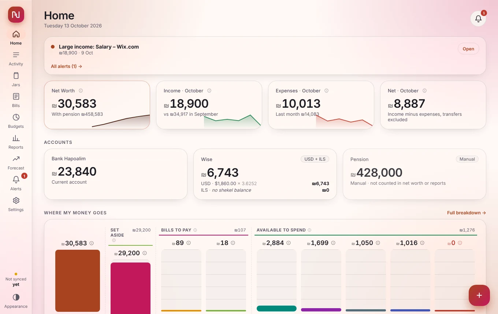
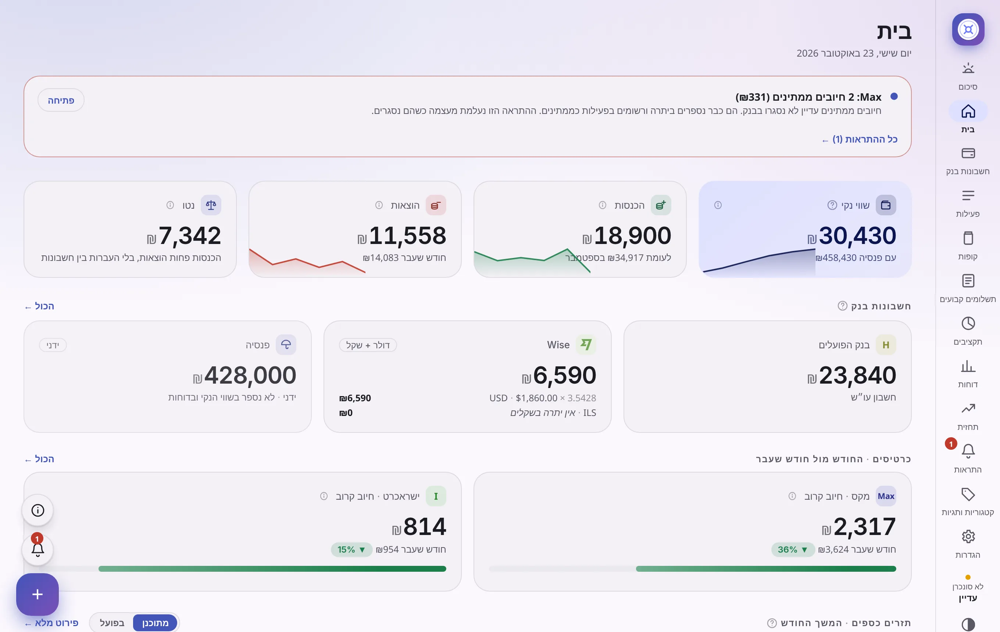
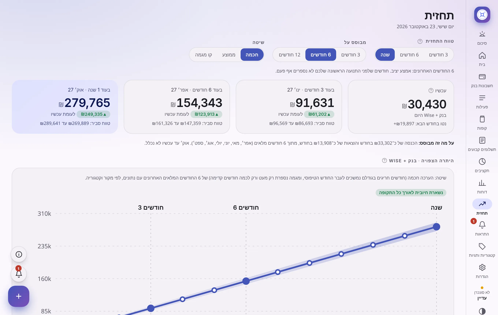
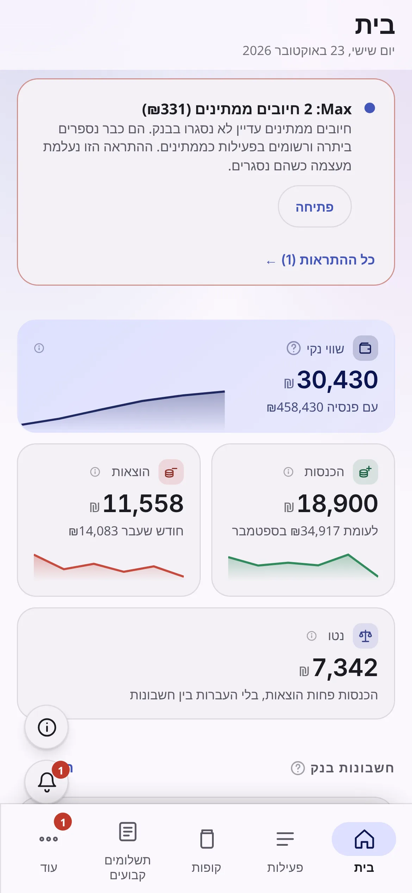
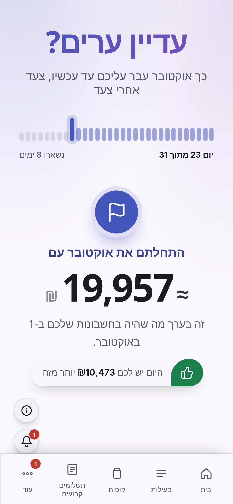
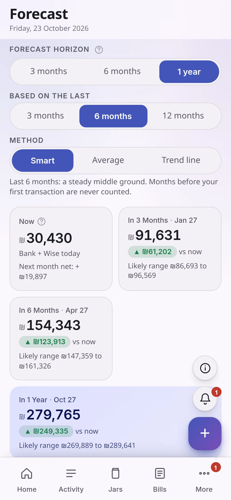

# Looks and languages

## Appearance

Open **Appearance** from the menu. Every change shows right away. It is saved **in that browser or app only**, so each device can look different, and your computer can be dark while your phone is light.

<table>
<tr>
<td><picture><source media="(prefers-color-scheme: dark)" srcset="screenshots/appearance-dark.webp"></picture></td>
<td><picture><source media="(prefers-color-scheme: dark)" srcset="screenshots/glass-dark.webp"></picture></td>
</tr>
</table>

| Choice | Options |
|---|---|
| **Mode** | **Light**, **Dark** or **Auto** (follows your phone or computer) |
| **Atmosphere** | The main colour: ten-plus colour sets, or **Custom** for any colour you pick |
| **Background** | **Glow**, **Mesh**, **Diagonal**, **Spotlight** or **Flat** (no effect) |
| **Texture** | A light pattern on top: **None**, **Dots**, **Stripes**, **Grid** or **Static**, with a density slider |
| **Surface** | How cards look: **Solid**, **Glass**, **Outline**, **Raised** or **Static** |
| **Corners** | **Round**, **Soft** or **Sharp** |
| **Density** | The space *inside* cards and rows: **Compact**, **Cozy**, **Roomy** |
| **Spacing** | The gap *between* cards and sections: **Tight**, **Standard**, **Loose**, **Wide** |
| **Font** | **Sans**, **Serif**, **Rounded** or **Mono** |
| **Navigation** | On a computer, side menu with **Labels** or **Icons only** |
| **App icon** | The symbol in the round logo: the **coin** (the app's own icon), or a shekel, dollar, euro, pound or yen |

**Glass** gives every card a blur of what is behind it. Three sliders appear: **Blur** (how frosted), **Vibrance** (how strong the colours behind it look) and **Opacity** (how see-through). It is the heaviest effect for your graphics card. If the app feels slow, switch the surface back to **Solid**.

> **Tip** Click the logo at the top of the side menu for a random new look.

## Language

**Settings → Preferences → Language** switches the whole app between **English** and **Hebrew (עברית)**. Hebrew also flips the page to **right to left**: the menu, the tables, the charts, the arrows and the numbers.

<table>
<tr>
<td><picture><source media="(prefers-color-scheme: dark)" srcset="screenshots/home-he-dark.webp"></picture></td>
<td><picture><source media="(prefers-color-scheme: dark)" srcset="screenshots/forecast-he-dark.webp"></picture></td>
</tr>
</table>

- The words are plain on purpose, in both languages. Nothing assumes you know financial terms.
- Words that come from your own data (a store's name, a category you made) stay as you wrote them. The app's own texts, the change history and server messages are shown in Hebrew.
- Words that depend on gender ("you") follow the **gender** you set in **Settings → Profile**.
- The desktop app's own windows and menus (the server list, the tray menu) also follow your computer's language.

## On a phone

On a narrow screen the menu moves to the bottom and the cards stack in one column. Everything above works the same.

<picture><source media="(prefers-color-scheme: dark)" srcset="screenshots/mobile-home-he-dark.webp"></picture>
<picture><source media="(prefers-color-scheme: dark)" srcset="screenshots/mobile-recap-he-dark.webp"></picture>
<picture><source media="(prefers-color-scheme: dark)" srcset="screenshots/mobile-forecast-dark.webp"></picture>

