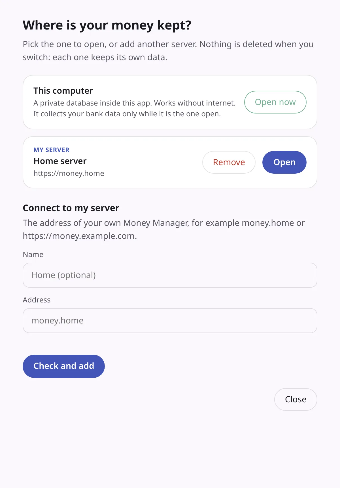
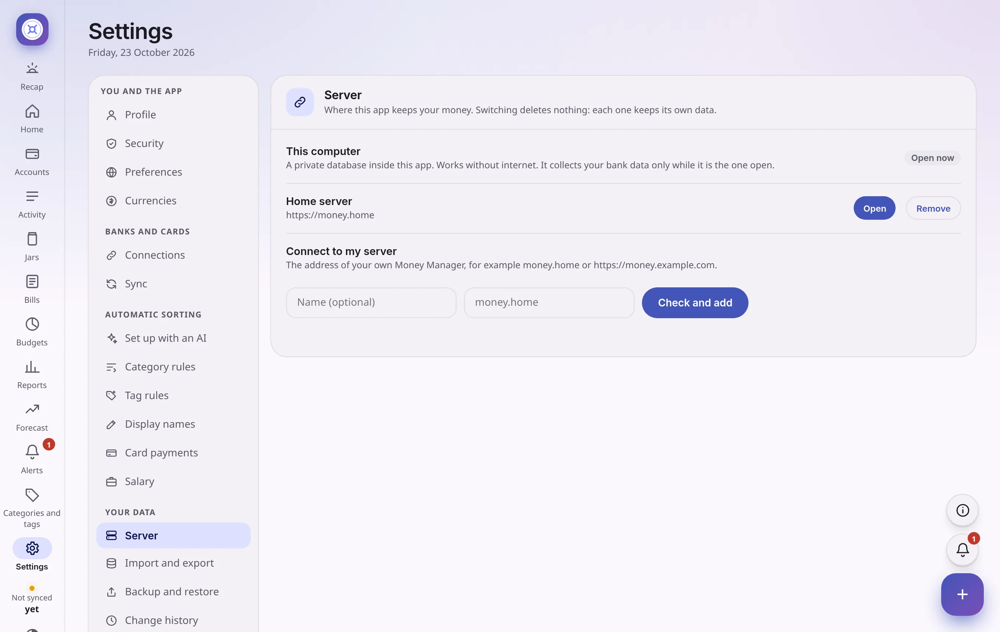

# Desktop app with your own server

The Windows and Linux apps can work in two ways. You choose, and you can change it later.

| | **This computer** | **My server** |
|---|---|---|
| What it is | The app keeps its **own private database** on this computer and collects your bank data itself | The app shows **its own screens** (the version you installed) with the **data from your Money Manager server** ([Docker](install-docker.md)) |
| Needs | Nothing | Your server's address |
| Works without internet | Yes, fully | Shows the last saved data, read-only |
| Collects bank data | While the app is running | Your server does it, around the clock |

You can keep **several** servers in one list and switch between them. A common set-up: **This computer** for yourself, plus **Home** for the family server.

<picture>
  <source media="(prefers-color-scheme: dark)" srcset="screenshots/desktop-servers-dark.webp">
  
</picture>

## Choose at the first start

The first time you open the app on a new computer, it asks **where your money is kept**.

- **This computer:** press **Open**.
- **My server:** type the address in the form, for example `money.home` or `https://money.example.com`, give it a name if you like, and press **Check and add**. The app checks that the address answers and that it really is a Money Manager before it saves it.

An app that was installed **before** this option existed keeps its data on **This computer** without asking.

## Change it later

You can open the server list from four places:

1. **Settings → Your data → Server**. You see every server, with **Open** and **Remove**, and the form to add one.
2. The **⋮** button at the left end of the title strip (or press **Alt** on its own), which opens the **Server** menu.
3. The **tray icon** (near the clock): **Switch to** lists them, **Servers…** opens the full list.

<picture>
  <source media="(prefers-color-scheme: dark)" srcset="screenshots/settings-server-dark.webp">
  
</picture>

## What happens when you switch

- **Nothing is deleted.** Each one keeps its own data. Removing a server from the list never touches the server or its data. It only forgets the address and the saved sign-in in this app.
- **Each server is separate.** You are signed in to each one on its own, and the app's saved copy (for offline use) is kept per server, so they never mix.
- **This computer keeps running in the background.** Once you have opened **This computer**, its private database and bank connector keep running, with automatic syncing, while you look at a server. They stop when you quit the app. (Your server keeps syncing on its own, of course.)

## Moving your data between them

They are separate on purpose, so switching does not move anything. To move your data from **This computer** to a server, make a backup in **Settings → Backup and restore** on the first, and restore it on the second. A backup never contains your bank logins, so you type those again on the new place.

## Security

- **The app only carries requests.** A small program on your computer (reachable only from your computer) serves the screens and passes the data requests on to your server. Your sign-in stays on your computer. The server's own pages, when shown instead, get no desktop controls: only the server list.
- **Unknown certificates need your OK.** If your server uses its own security certificate (common for a home server), the app shows the certificate's **fingerprint** and asks whether to trust it **for that server only**. It then remembers that exact certificate. If the certificate ever changes, you are asked again.
- Use `https://` for anything beyond your own home network.

## How My server mode works

The desktop app is a **real app**: you see the screens of the version you installed, and it updates itself. For the data it **talks to your server**: your payments, your categories, the saved bank logins and the bank scraper all stay on the server. (The app cannot use the server's database directly: the server holds the key to your saved logins and does the bank syncing, so the app asks the server.)

- **They need to fit, not to be the same version.** The server and the app each say which "API level" they speak (a small number that only changes when the app starts to need something new from the server). The app's own screens are used when the server's level is one the screens work with, and the other way round. So an app and a server of different versions work together for as long as they fit, and you can update them on different days. If they do not fit, or the server is older than 0.12.1 and does not say, the app shows **the server's own pages** instead and tells you. Update the server (or the app) and it switches by itself the next time you open it.
- **Settings → Version and updates** shows the **app's** version and updates, also in this mode. The server's version is shown by the server itself, on its own pages.
- **Backups** are made by the server, so the backup folder is a folder **on the server**.
- Offline, you see the last saved copy, read-only, as on a phone.

## When the server does not answer

When the server's own pages are shown and the server does not answer at start, the app asks whether to **try again**, **choose another server**, or quit. When the app's own screens are shown, they open anyway, and if you used the server before over `https://` you see the saved read-only copy.

## Hebrew

The server list, the menus and the questions are in English and Hebrew, chosen from your computer's language.

## Related

- [Install with Docker](install-docker.md) to set up the server.
- [Install on Windows](install-windows.md), [Install on Linux](install-linux.md).
