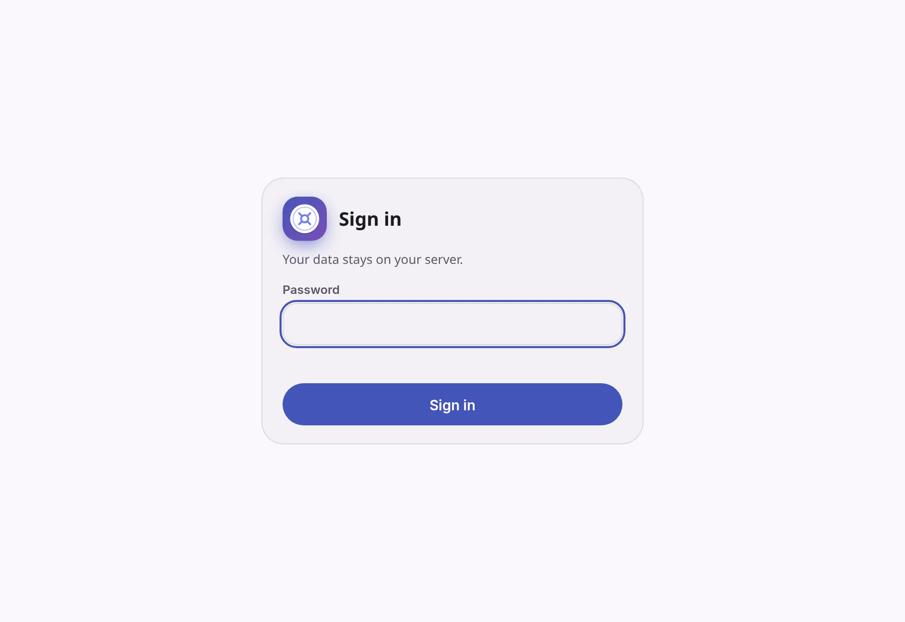
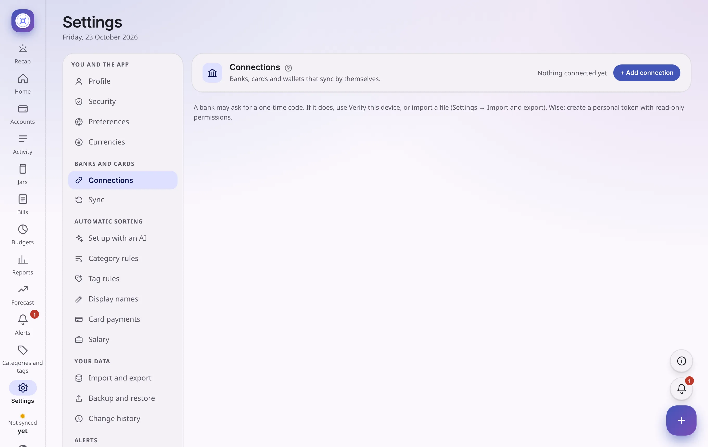

# Your first 15 minutes

You have [installed it](install.md). This page takes you from an empty app to one that shows your real money. You do not need to do everything today. Steps 1 to 4 are enough to see your numbers.

> **Tip** Only the accounts you connect or import appear in the app. Nothing is pre-filled, so an empty Home screen at the start is normal.

## 1. Choose a password

The first time you open the app it asks you to choose a password (at least 10 characters). It protects your financial data and is stored only as a one-way hash on your own computer or server. Use one you use nowhere else.

<picture>
  <source media="(prefers-color-scheme: dark)" srcset="screenshots/signin-dark.webp">
  
</picture>

## 2. Turn on two-factor sign-in (recommended)

Go to **Settings → Security → Two-factor sign-in** and press **Set up**. You get a key to add to an authenticator app (Aegis, Google Authenticator, 1Password and similar). From then on, signing in needs your password **and** a 6-digit code from your phone, so a stolen password is not enough.

## 3. Connect your accounts

Go to **Settings → Connections**.

1. In **Add a connection**, pick your bank, card company or Wise, and press **Add**.
2. Type your login (the same one you use on the bank's website) and press **Save**. It is stored encrypted and is **never shown again**, not even to you. To change it later you type it again.
3. Press **Test connection**. It reads the last 30 days and saves nothing, so you can check that the login works. Test **one at a time**.

<picture>
  <source media="(prefers-color-scheme: dark)" srcset="screenshots/settings-connections-dark.webp">
  
</picture>

**Good to know**

- **Two logins at one company?** Two Wise accounts, or two sets of cards? Pick the same company again (it says "another login") and give each a **nickname** so you can tell them apart.
- **Several cards under one login** each get their own account and balance.
- **Two failed logins in a row pause the source** so the bank never locks you out. Fix the login, then press **Unlock**.
- **The bank sent a text message with a code?** That happens on a device the bank does not know. Press **Verify this device** once. A live view of the app's own browser opens, you type the code and tick "remember this device", then press **Done**. Later syncs should not ask again. See [Troubleshooting](troubleshooting.md#the-bank-asks-for-a-one-time-code).
- **Your bank is not on the list?** Import a file instead (step 5).

## 4. Sync

Press **Sync now**. The first sync reads the history period you chose (it asks the bank for that much and keeps whatever the bank still has, usually one to two years). After that it syncs **by itself**, every 8 hours by default, even when the app is closed (on a server) or only running in the tray (on a computer). Opening the app never starts a sync.

You can change how often, at what time and how far back in **Settings → Sync**. **Import history** on a connection reads further back later, once, without duplicating anything.

Now open **Home** and **Activity**. Your money is there.

<picture>
  <source media="(prefers-color-scheme: dark)" srcset="screenshots/activity-dark.webp">
  
</picture>

## 5. No connection for your bank? Import a file

In **Settings → Import and export**:

- **Import Wise CSV** adds a Wise statement.
- **Choose CSV file** adds an export from a bank or a card. First choose the **Account** it belongs to. Tick **Charges are shown as positive numbers (cards)** if your card file lists spending as plus numbers.

Rows already imported are skipped, so importing the same file twice is safe.

## 6. Add what the banks cannot show

- **Your pension, cash, savings elsewhere, a loan:** in **Accounts**, press **+ Add an account**. Type a name, a type, a currency and today's balance. For a loan, type what you owe as a minus number. You can update it by hand whenever you like, and the old balance is kept in a history.
- Choose whether it counts in your **net worth** and in your **reports**.

## 7. Let the app sort your payments

The app comes **without** categories, so it does not guess wrong. You have two ways to set it up:

- **With an AI chat you already use.** In **Settings → Automatic sorting → Set up with an AI**, download the *names* in your transactions (no amounts, no dates, no account numbers), copy the instructions into any AI chat, and it first shows you a table to check. Nothing is added until you tick the rows you agree with.
- **By hand.** Make categories and short rules like "if the description contains Wolt, it is Eating out". The rules run on every new payment and never overwrite what you set yourself.

More in [Sorting that does itself](automatic-sorting.md).

## 8. Check what needs a look

Open **Activity → Needs review**. This is where the app puts what it is not sure about, so it never guesses silently:

- **Transfers between your accounts:** it thinks money moved from one of your accounts to another. Press **Confirm**, or **Not a transfer**.
- **Possible duplicates:** the same amount, store and day twice. **Delete this copy** or **Keep both**.
- **Balance changes with no transaction:** a bank balance moved but nothing explains it. Add the payment, import the missing statement, or mark it reviewed with a note.

## 9. Plan ahead (when you are ready)

- **Bills** are found for you after the same store charges you a few times. Check the list.
- **Budgets** are suggested from what you really spent, after about two full months of history. You accept the ones you like.
- **Jars** let you set aside money inside your account for a goal. Nothing moves at the bank.
- **Alerts** tell you when something needs you. To get them on your phone, see [Alerts and notifications](alerts-notifications.md).

A short guide for each page is one press of the **?** button away.

## Where to next

- [A tour of every screen](tour.md)
- [How it works](how-it-works.md), for the details behind bills, jars, budgets and the forecast
- [Troubleshooting](troubleshooting.md)
