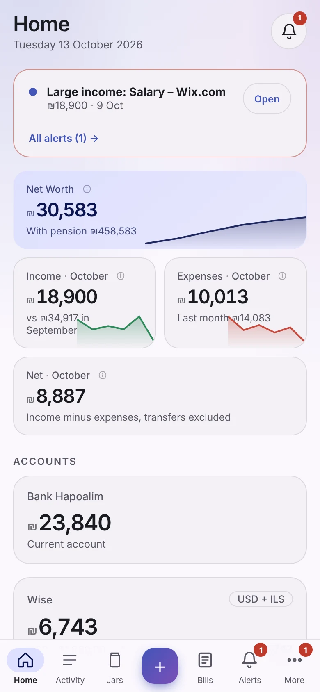
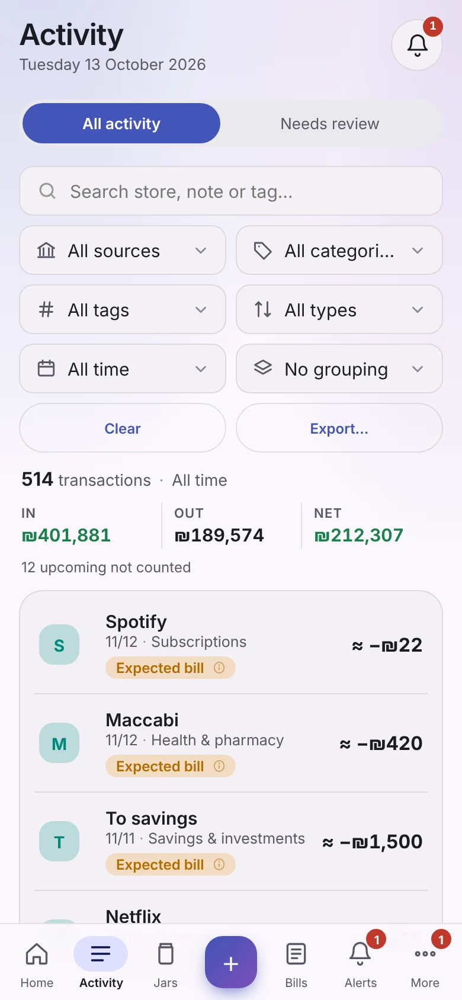

# Money Manager on your phone

There is no app to download from a store. Instead, you open your own Money Manager in the phone's browser and **add it to the home screen**. It then opens full screen with its own icon, like any other app, and it can send **notifications**.

> **Note** The phone shows and edits the data that lives on **your server** ([Docker install](install-docker.md)). A phone cannot collect bank data by itself, so the server does that and the phone just looks at the result.

## Before you start

- Your Money Manager runs on a home server and you can open it from the phone (see [Use it from your other devices](install-docker.md#use-it-from-your-other-devices)).
- **It must be an `https://` address.** A phone only installs apps and allows notifications for secure addresses. [Tailscale](install-docker.md#option-2-https-with-caddy-or-tailscale-recommended) gives you one in a few minutes.

## Android (Chrome, Edge, Samsung Internet)

1. Open your Money Manager address and sign in.
2. Open **Settings → Version and updates → Install this app** and press **Install app**. Or use the browser menu **⋮ → Install app** (some browsers say **Add to Home screen**).
3. Open it from the new icon on your home screen.

## iPhone and iPad (Safari)

1. Open your Money Manager address **in Safari** and sign in.
2. Tap the **Share** button, then **Add to Home Screen**, then **Add**.
3. Open it from the new icon. (Phone notifications need **iOS 16.4 or newer**, and only work for an app added to the home screen.)

## Phone notifications

You get an alert on the phone when something needs you (a bill coming, a budget used up, a payment that looks wrong), **even when the app is closed**.

1. Open the app **from the home screen icon**.
2. Go to **Settings → Notifications → Phone push**.
3. Press **Turn on for this device**, and allow notifications when the phone asks.
4. Press **Send a test** to check that it works.

Each alert is sent to a device **once**. If you open the app again, it does not repeat alerts it already told you about. If an alert goes away and comes back later, you are told again.

> **Tip** Which kinds of alerts you get is set in **Settings → Which alerts**. More in [Alerts and notifications](alerts-notifications.md).

## Without internet

The app keeps the last data on the phone. With no connection it opens **read-only** and a banner says you are looking at saved data. It needs to have been opened once over `https://` first.

## It looks like an app

On a phone the menu moves to the bottom and the layout fits a narrow screen. Everything works in English and Hebrew, right to left. Light, dark or automatic follows your phone.

<picture><source media="(prefers-color-scheme: dark)" srcset="screenshots/mobile-home-dark.webp"></picture>
<picture><source media="(prefers-color-scheme: dark)" srcset="screenshots/mobile-activity-dark.webp"></picture>
<picture><source media="(prefers-color-scheme: dark)" srcset="screenshots/mobile-forecast-dark.webp"></picture>

## Something wrong?

- **No "Install app" button?** The address is not `https://`, or you are in a private window. Open the normal browser at the secure address.
- **Notifications do nothing?** Open the app from the home screen icon (not a browser tab), turn on **Phone push** again, and press **Send a test**. On iPhone check iOS is 16.4 or newer.
- More in [Troubleshooting](troubleshooting.md).
