# A tour of every screen

The menu is on the left on a computer and at the bottom on a phone. Each page is described below in the order you see them. On any page, the **?** button opens a short guide for that page, and pointing at (or tapping) most numbers shows how they were worked out.

> **Note** The screenshots use made-up demo data. Light and dark are the same app: it follows your computer or phone, or you choose in **Appearance**.

## Home: today's picture

Home is a summary. Each box is a small version of another page, and **All →** on a box opens the full page. A box only appears when it has something to show.

<picture>
  <source media="(prefers-color-scheme: dark)" srcset="screenshots/home-dark.webp">
  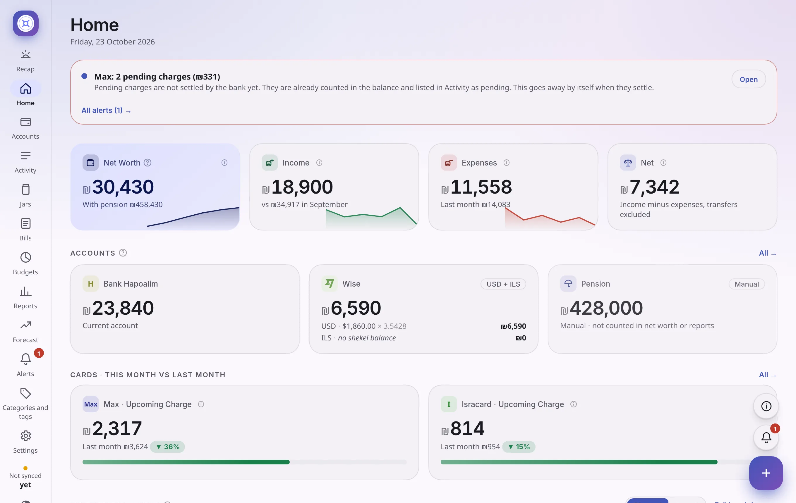
</picture>

- **The four big numbers.** **Net worth** is the money you have in your bank and Wise right now, plus any account of your own that you chose to count. Credit cards are not included, because a card is a bill, not money you have. A small line shows the total **with pension**. **Income** is money that came in this month. **Expenses** is money that went out. **Net** is income minus expenses: what you kept.
- **Alerts at the top.** If something needs you, up to three alerts show above everything. **Open** goes to the thing the alert is about.
- **Accounts and credit cards.** Each account with its balance. For a card, what you charged so far this month next to last month.
- **Money flow, ahead.** A plan for the money you have right now, for the rest of the month: your balance, then what is held in jars, a safety cushion, and what you still plan to spend on each budget and bill.
- **Spending by category, budgets, bills, recent activity and jars.** Small versions of those pages.

## Recap: your month as a story

Recap tells you how the month is going in plain sentences, with a small graph next to each one. It changes with the time of the month (beginning, middle, end).

<picture>
  <source media="(prefers-color-scheme: dark)" srcset="screenshots/recap-dark.webp">
  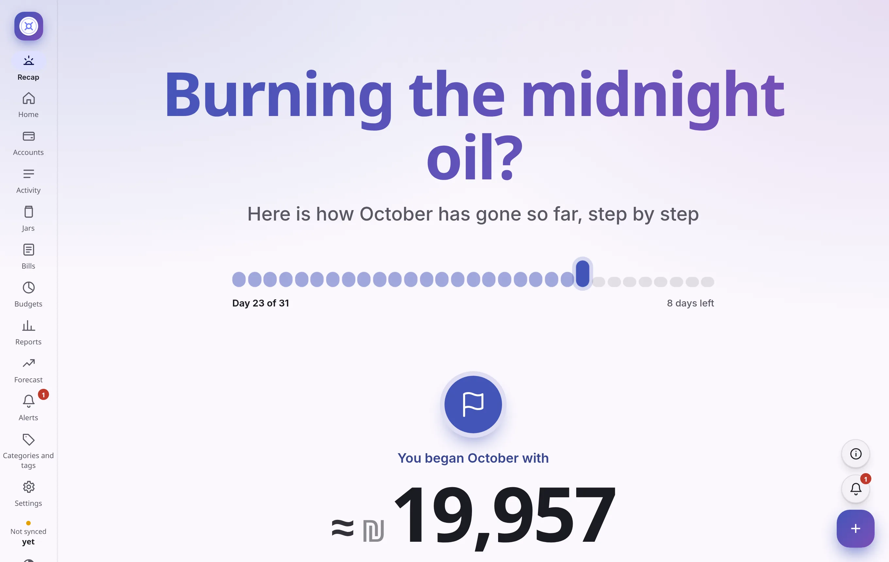
</picture>

<picture>
  <source media="(prefers-color-scheme: dark)" srcset="screenshots/recap-scroll-dark.webp">
  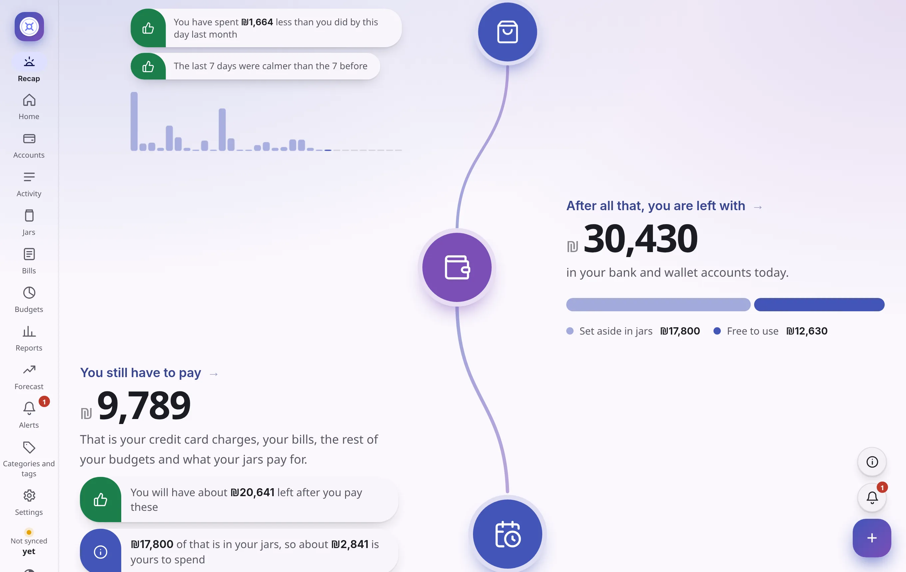
</picture>

It starts with what was in your accounts at the beginning of the month, what came in, the biggest payment, and how you compare with the same day last month. Then **Since then, you have spent**, a bar for each day (hover a bar to see the day, click it to open it), and finally **After all that, you are left with**: what is in your accounts today, what is still to be paid this month, and how much of it is really yours to spend after your jars.

## Activity: every payment

Think of it as your bank statement, but for **all accounts together**. Newest first. Green came in. Black went out.

<picture>
  <source media="(prefers-color-scheme: dark)" srcset="screenshots/activity-dark.webp">
  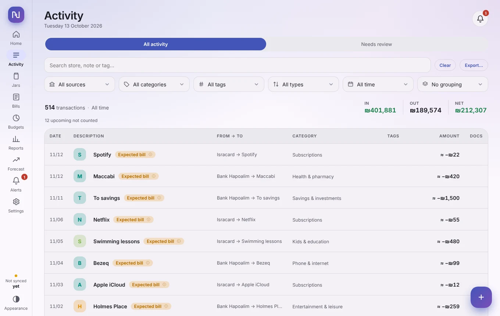
</picture>

- **Search and filters:** by account, category, tag, type (income, expenses, transfers, bills, card payments) and date range. The list can be grouped by day, week, month or category.
- **The totals strip** shows how many payments you see and the In, Out and Net for them. A note like **3 not counted** means some rows are transfers, card bill payments or upcoming payments. They are shown but not added, so nothing is counted twice.
- **Tags on a row** explain special rows: *Expected bill*, *Upcoming*, *Bill*, an instalment like *3/4*, *Pending*. If a row has many, the most important ones are shown first and the rest are in a small **+N** tag.
- **Click a store** to open the payment: every detail the bank sent, category, tags, a note, and a receipt you can attach. One-click tiles let you mark it as a bill, attach it to a jar, or leave it out of all totals.
- **Needs review** holds what the app is not sure about: transfers to confirm, possible duplicates, and balance changes with no payment to explain them.
- **Export…** saves what you see as a CSV or JSON file.

## Accounts

Every account the app knows about: banks, credit cards, wallets (Wise) and your own accounts such as cash or a pension. Open one for its own activity. A badge shows its state: *Connected*, *Out of date*, *Needs a code*, *Locked* or *Entered by you*.

<picture>
  <source media="(prefers-color-scheme: dark)" srcset="screenshots/accounts-dark.webp">
  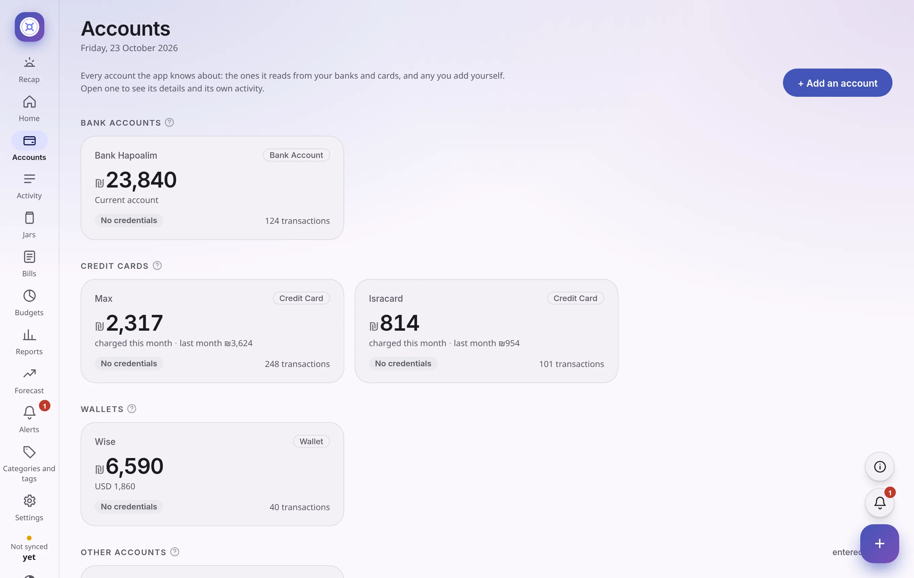
</picture>

## Jars: set money aside

A jar is a pot of money **inside the app**, for a goal or for something you will need later. **No real money moves at the bank.** Jars fill from your **free** money, in the order you choose, so you never set aside money you do not really have.

<picture>
  <source media="(prefers-color-scheme: dark)" srcset="screenshots/jars-dark.webp">
  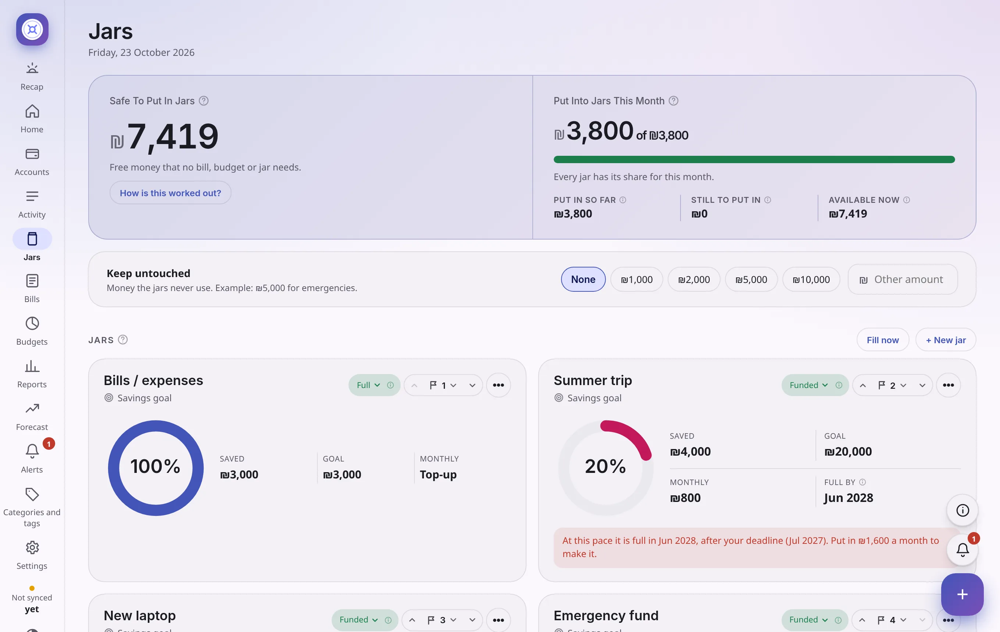
</picture>

- **Safe to put in jars** is your free money: your accounts, minus what is already in jars, minus a cushion you keep untouched, minus bills still to pay this month, minus the unspent part of your budgets. **How is this worked out?** shows the list.
- **Three kinds:** *Savings* (a goal and an optional date and monthly amount), *Bills* (keep money for your bills) and *Pay-off* (a loan you pay back).
- Each card shows the ring (how full), **Saved**, **Goal**, **Monthly** and **Full by**.
- Jar number 1 gets money first. Change the order with the arrows.

## Bills: what is coming

When the same store charges you again and again, it becomes a bill and the next payment is predicted. The category does not matter: car insurance is a bill whatever its category.

<picture>
  <source media="(prefers-color-scheme: dark)" srcset="screenshots/bills-dark.webp">
  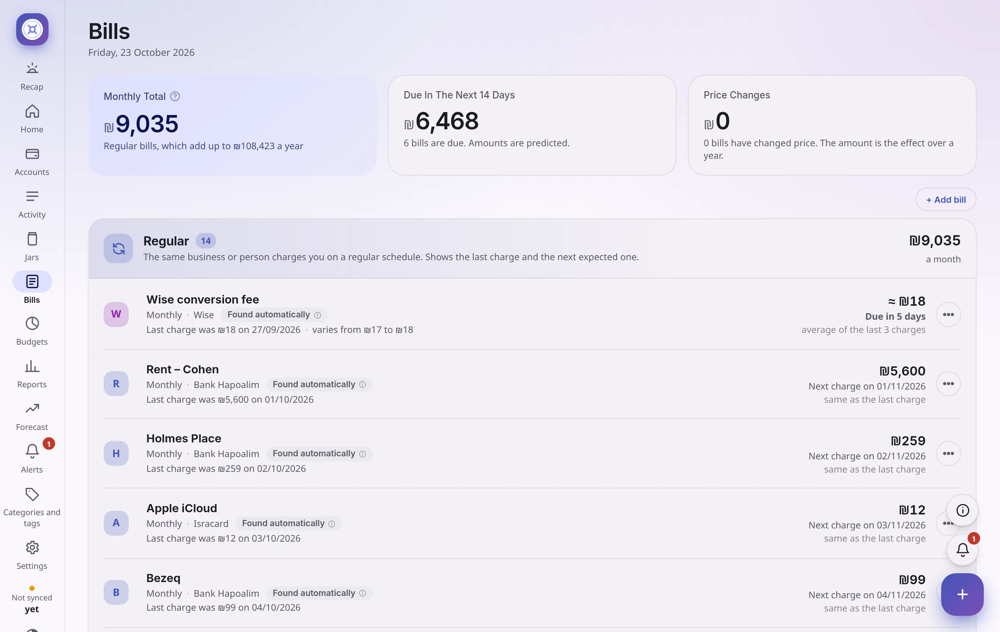
</picture>

- **Four kinds:** *Recurring* (found automatically), *Irregular* (you said every payment to that store is a bill, like water), *Instalments* (payment 3 of 10) and *One-off*.
- **≈ in front of an amount** means it changes from month to month. It is the average of the last three.
- **Predicted bills are information only.** They are not counted as spending until they are really paid, and they never change your balances. The one place they matter is the *available* figure, which holds back bills due this month so it shows what is truly free.
- The **⋯** menu on a row: history, change type, **Mark to cancel** (for a subscription you plan to stop) and remove.

## Budgets: am I spending too fast?

A budget is a limit for one category for one month, like Groceries ₪2,600. It starts again on the 1st.

<picture>
  <source media="(prefers-color-scheme: dark)" srcset="screenshots/budgets-dark.webp">
  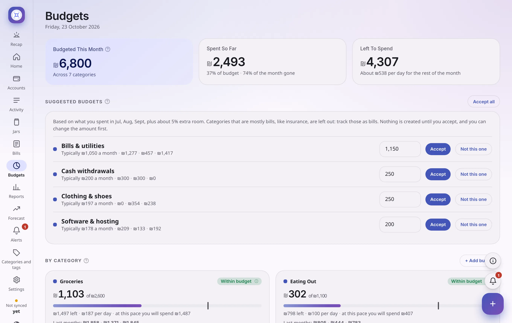
</picture>

- The **thin line on a bar is today's date in the month**. If the colour is past the line, you are spending faster than the month is passing.
- Badges: **Within budget**, **Likely to go over** (fine today, but at this pace you will pass the limit), **Almost at the limit** (80% or more, you can change that) and **Over by ₪X**.
- **Suggested budgets** appear after two full months of history, from what you really spent plus about 5% room. You press **Accept** on the ones you like. Nothing is created without you.

## Reports: how your money moves

Charts built from your payments, month by month. Transfers between your own accounts and card bill payments are not included.

<picture>
  <source media="(prefers-color-scheme: dark)" srcset="screenshots/reports-dark.webp">
  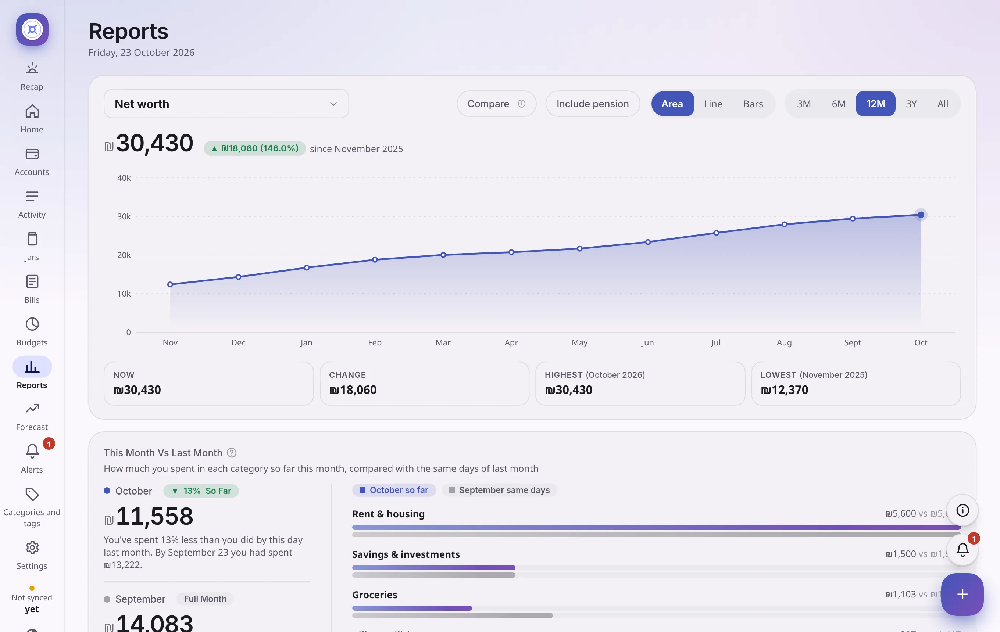
</picture>

Choose what to look at (net worth, income, expenses, net cash flow, bills, one category, one income source or one tag) and how far back (3 months to all). Turn on **Compare with the previous…** to draw the period just before it. Click almost anything (a slice, a bar, a dot) to see the payments behind it.

## Forecast: where you are heading

The forecast answers: *if I keep living like this, how much will I have in 3 months, 6 months, a year? Will I go below zero?* It uses **no AI and no magic**: it takes your past months and continues them. It is not a promise.

<picture>
  <source media="(prefers-color-scheme: dark)" srcset="screenshots/forecast-dark.webp">
  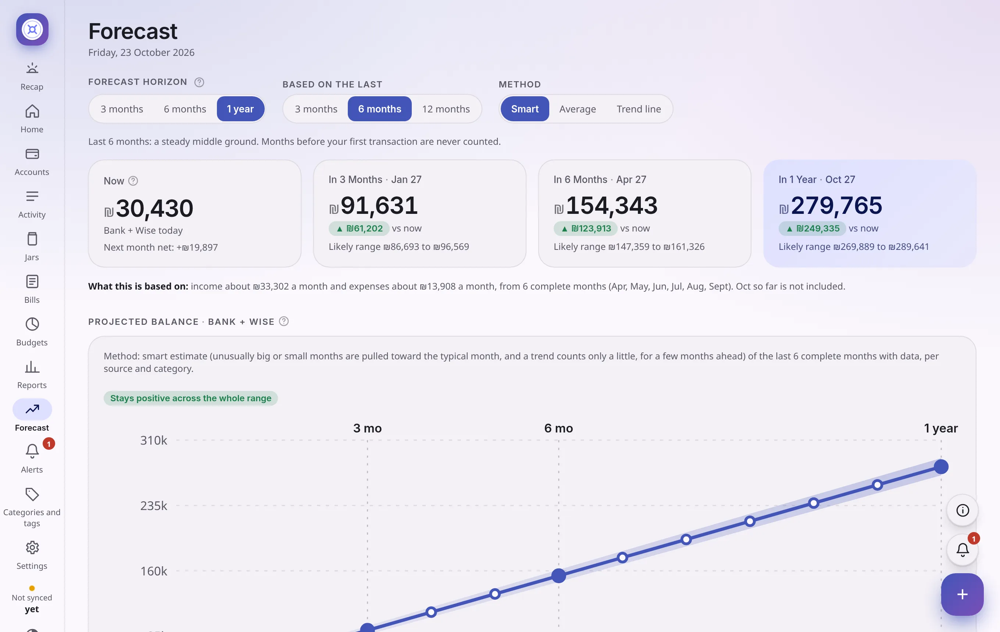
</picture>

- Three choices on top: **how far** the chart goes, **how many past months** to learn from (3 follows changes fast, 12 includes yearly costs but is slow to notice a new salary), and the **method**.
- **The line** is the expected balance. **The shaded area** is the likely range, wider the further away.
- Income that arrived once (a refund, a single transfer) is left out, because it would not repeat. Income that arrives in two or more months counts as recurring.
- The table below shows what drives it: what each income and cost **usually** is, **next month**, and its **direction**. Under it, a small chart for each jar shows when it will be full.

## Alerts

Short messages about things that may need you. The bell number is how many are showing.

<picture>
  <source media="(prefers-color-scheme: dark)" srcset="screenshots/alerts-dark.webp">
  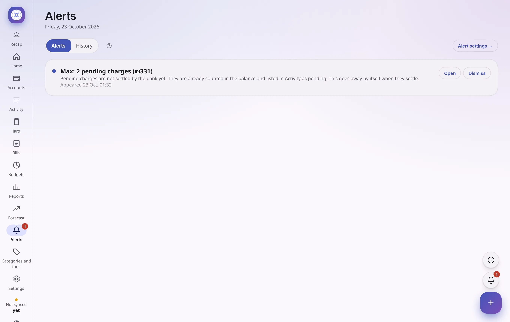
</picture>

Each alert has a colour for how urgent it is, a short line with the numbers, and when it first appeared. **Open** goes to the right place. **Dismiss** hides it, and a dismissed alert does not come back unless it is new. The **History** tab keeps every alert that ever appeared. To change what you get, see [Alerts and notifications](alerts-notifications.md).

## Categories and tags

Where your money goes, per category and per tag, for the last 3, 6 or 12 months: what went out, what came in, a **usual month**, and how it changed. Add, rename or delete from the **⋯** on a row. Deleting never deletes payments.

<picture>
  <source media="(prefers-color-scheme: dark)" srcset="screenshots/categories-dark.webp">
  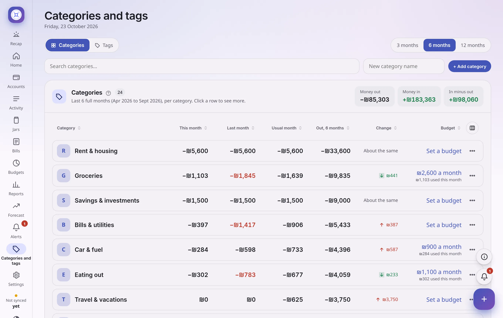
</picture>

## Settings

Everything you can change, in six groups: *You and the app* (profile, security, preferences, currencies), *Banks and cards* (connections, sync), *Automatic sorting*, *Your data* (import and export, backup and restore, change history), *Alerts* and *About* (version and updates, change log, error log).

<picture>
  <source media="(prefers-color-scheme: dark)" srcset="screenshots/settings-sorting-dark.webp">
  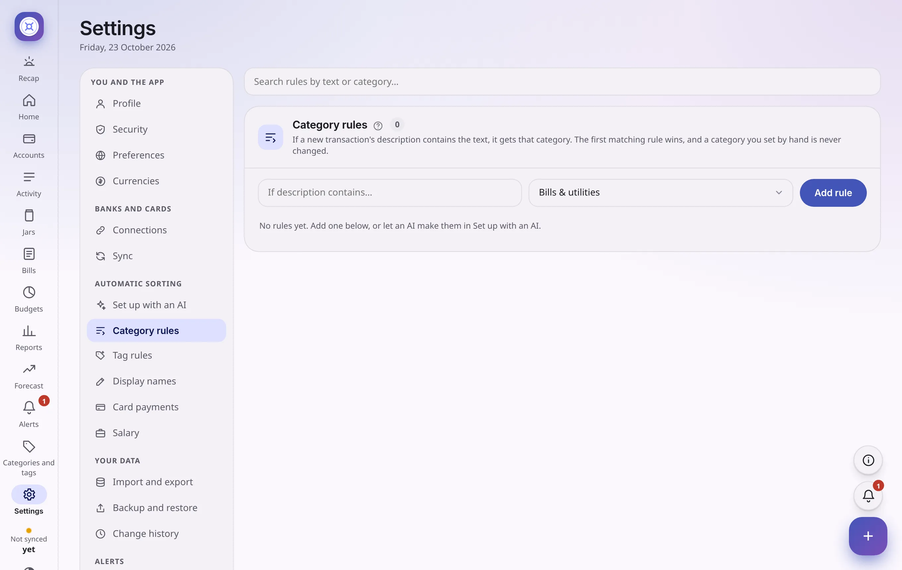
</picture>

Every change you make is written to **Change history**, with who did it and when, and most can be **undone** from the small "Saved" message or from the history. Nothing here changes your real bank. It is only a record inside the app.

## Two buttons on every page

- **+** adds or updates things from any page: a payment, an account balance, a bill.
- **?** opens a short guide for the page you are on.

## In Hebrew

Everything above is available in Hebrew, right to left, including the numbers, charts and menus. Switch the language in **Settings → Preferences**.

<picture>
  <source media="(prefers-color-scheme: dark)" srcset="screenshots/activity-he-dark.webp">
  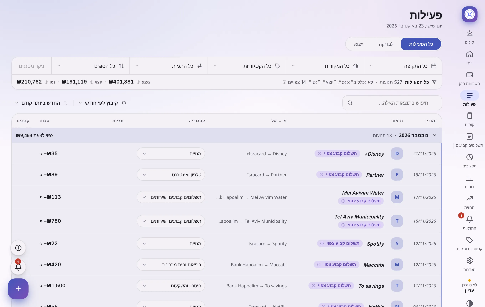
</picture>
